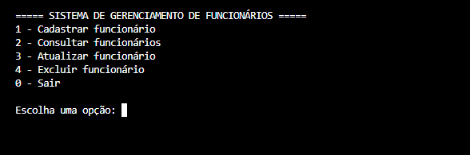
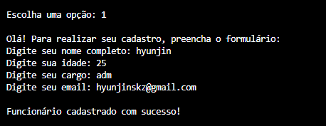
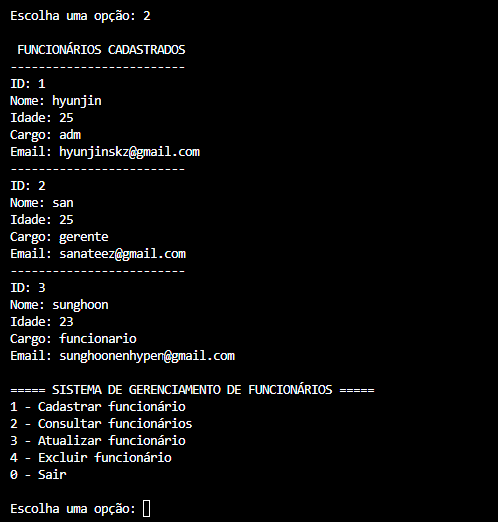
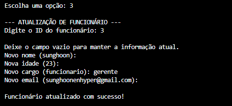
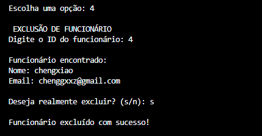

# sistema-gerenciamento-de-funcionarios
## Nome do Projeto: **Sistema de gerenciamento de funcionários.**

**Descrição:** Ele permite que os usuários  de uma empresa se cadastrem, permite consultar os cadastros, atualizar ou excluir informações dos funcionários.

**Objetivo:** Facilitar o sistema de gerenciamento de funcionários, com os dados de forma fácil e organizada de achar ou acessar.

**Nome integrante:** Maria Eduarda

### **Tecnologias:** 
Python / JSON / Git / GitHub / Visual Studio Code


### **Funcionalidades:**

- *Cadastrar funcionário:* permite adicionar um novo funcionário, informando nome, idade, cargo e e-mail.
- *Consultar funcionários:* permite visualizar os funcionários cadastrados.
- *Atualizar funcionário:* permite modificar as informações de um funcionário existente.
- *Excluir funcionário:* permite remover um funcionário cadastrado, com confirmação antes da exclusão.
- *Menu interativo:* permite escolher qual operação deseja realizar.

### Instruções para instalação e execução:
1. **Instale o Python no computador.**
2. **Faça o download ou clone este repositório.**
3. **Abra a pasta do projeto no Visual Studio Code.**
4. **Abra o terminal na pasta principal.**
5. **Execute o comando: No terminal main.py use "python src/main.py" para o código iniciar.**

### **Armazenamento dos dados:** 
- Os dados dos funcionários são armazenados no arquivo funcionarios.json, localizado na pasta data.
- O formato JSON permite salvar as informações e recuperá-las quando o sistema for executado novamente.

### **A estrutura do Projeto:**

```
sistema-gerenciamento-de-funcionarios/
│
├── data/
│   └── funcionarios.json
│
├── imagens/
│   ├── atualizacao.png
│   ├── cadastro.png
│   ├── consulta.png
│   ├── exclusao.png
│   └── menu.png
│
├── src/
│   ├── atualizacoes.py
│   ├── consultas.py
│   ├── exclusoes.py
│   ├── funcionarios.py
│   └── main.py
│
├── .gitignore
└── README.md
```

### Exemplos de utilização do sistema:

**Ao executar o programa, será apresentado um menu com as opções disponíveis:**

- *Cadastrar funcionário:* o usuário escolhe a opção 1 e informa nome, idade, cargo e e-mail.
- *Consultar funcionários:* o usuário escolhe a opção 2 para visualizar os funcionários cadastrados.
- *Atualizar funcionário:* o usuário escolhe a opção 3, informa o ID do funcionário e altera os dados desejados.
- *Excluir funcionário:* o usuário escolhe a opção 4, informa o ID do funcionário e confirma a exclusão.
- *Sair:* o usuário escolhe a opção 0 para encerrar o sistema.

### Imagens do sistema:

### *Menu principal:*


### *Cadastro de funcionário:*


### *Consulta de funcionários:*


### *Atualização de funcionário:*


### *Exclusão de funcionário:*

